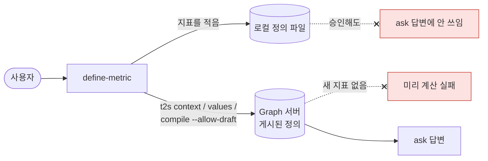
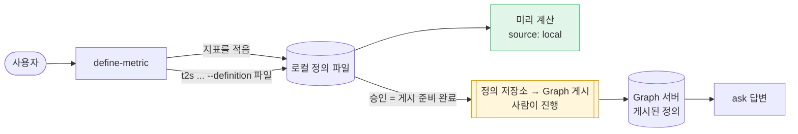
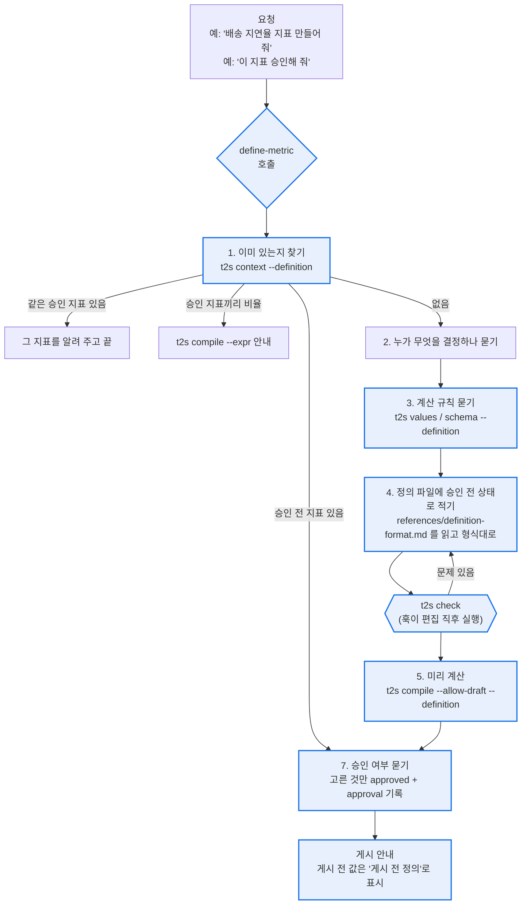
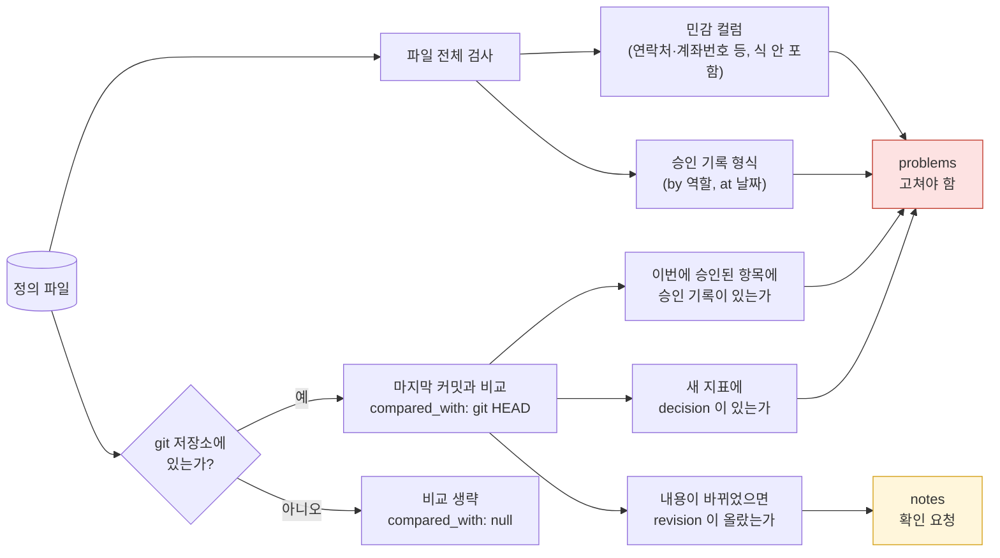
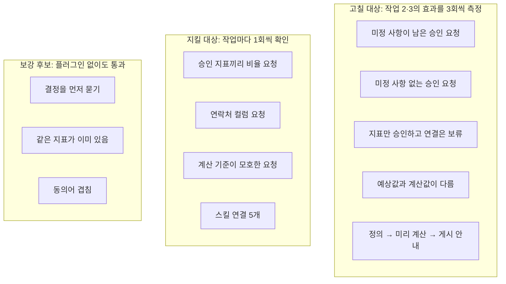
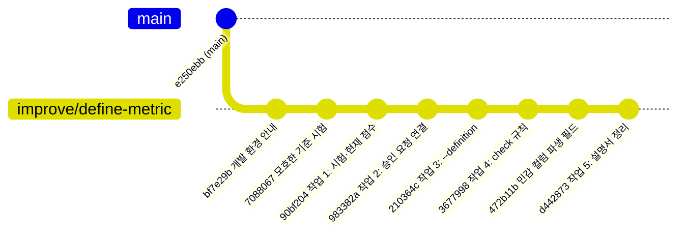

# `improve/define-metric` 브랜치 작업 요약

- 기준: `main` 커밋 `e250ebb`
- 범위: 작업 커밋 8개와 문서 정리 커밋, 2026-11-21 ~ 2026-11-24
- 관련 문서: [작업 정리 (글)](work-summary.md), [고도화 계획안](improvement-plan.md)

## 한눈에 보기

지표 정의 에이전트(`define-metric`)로 만든 지표가 **정의 → 미리 계산 → 승인**까지 끊기지 않고 이어지게 했다. 각 변경의 효과는 시험(evals)으로 확인했다.

| 작업 | 무엇을 했나 | 결과 |
|---|---|---|
| 1. 시험 환경과 현재 점수 | 시험 10개 추가(총 16개), `main` 점수 측정 | 문제 2개를 점수로 확인 |
| 2. 승인 요청 연결 | 스킬 설명에 승인·검토 용도 추가 | 스킬 호출 3/12 → 12/12 |
| 3. 정의를 읽는 곳 정리 | `t2s`에 `--definition <파일>` 추가 | 미리 계산 0/3 → 4/4 |
| 4. 규칙 검사 이동 | `t2s check`에 규칙 5개 추가 | 시험 점수 유지, 단위 테스트 125개 통과 |
| 5. 설명서 정리 | 작성 형식 세부를 참고 문서로 분리 | `SKILL.md` 147 → 119줄, 점수 유지 |

## 1. 무엇이 바뀌었나: 정의를 읽는 곳

### 바꾸기 전 (`main`)

에이전트는 지표를 **로컬 정의 파일**에 적었다. 그런데 미리 계산과 답변은 **Graph 서버**의 정의를 읽었다. 그래서 방금 만든 지표가 보이지 않았다.

### 바꾼 뒤 (이 브랜치)

지표를 정의하는 동안에는 `t2s ... --definition <파일>`로 **로컬 정의 파일만** 읽는다. 승인은 "게시 준비 완료"를 뜻한다. Graph에 게시된 뒤에 질문 답변(ask)에 쓰인다.

**전제**: 로컬 정의 파일(정의 저장소)이 원본이고, Graph는 그 파일을 게시한 것이다. Graph에만 있는 지표가 생기는 운영 방식이라면 이 전제가 깨지므로, 지표를 찾는 단계에 Graph 확인을 추가해야 한다.

## 2. 지표 정의 흐름과 이번에 바뀐 곳

파란 테두리가 이번에 바뀐 곳이다.

| 바뀐 곳 | 작업 | 내용 |
|---|---|---|
| define-metric 호출 | 2 | "~ 지표 승인해 줘" 같은 요청도 이 스킬로 온다 |
| 1·3·5단계 명령 | 3 | 모든 `t2s` 명령에 `--definition <정의 파일>` |
| 4단계 작성 형식 | 5 | 형식 세부는 참고 문서(`references/definition-format.md`)로 옮기고, 본문에는 꼭 지킬 규칙만 둔다 |
| 편집 직후 검사 | 4 | 민감 컬럼, 승인 기록, 새 지표의 결정, `revision` |
| 7단계 승인 | 3·4 | 승인 기록(역할·날짜)을 함께 적고, 승인은 "게시 준비 완료"로 안내 |

## 3. `t2s check`에 추가한 규칙 (작업 4)

예전부터 있던 지표에 경고가 쏟아지지 않도록, 일부 규칙은 git 마지막 커밋과 비교해 **이번에 바뀐 것**에만 적용한다.

## 4. 시험 체계 (작업 1)

시험 16개를 두 묶음으로 나눠 쓴다.

- 시험 준비: 시나리오마다 작업 폴더에 `olist.db`와 시험용 정의 파일을 복사하고, 정의 파일을 git에 한 번 커밋한다(`evals/_scaffold/`).
- 채점: LLM 판정과 함께 결정적 채점을 둔다. 정의 파일의 최종 상태는 정규식으로, 도구 호출은 호출 기록으로 본다.
- Graph 서버는 쓰지 않는다. 지표 정의가 Graph 없이 되는지가 이번 작업의 전제이기 때문이다.

## 5. 시험 결과 변화

| 시험 | `main` (3회) | 작업 2 | 작업 3 | 작업 4 | 작업 5 (3회) |
|---|---|---|---|---|---|
| 승인·검증 4개: 스킬 호출 | 3/12 | **12/12** | 4/4 | 4/4 | 12/12 |
| 정의 → 미리 계산: 결과 제시 | 0/3 | 0/1 | **4/4** | 1/1 | 3/3 |
| 일부 승인: 승인 기록 남김 | — | — | — | **6/6** | 3/3 |
| 나머지 지킬 대상·보강 후보 | 통과 | 통과 | 통과 | 통과 | 통과 (채점 오판 1건) |
| 모든 항목을 통과한 회차 | — | — | — | — | 정리 전 47/48 → 정리 후 46/48 |

`—`는 아직 해당 채점이 없던 시점이다. 작업 2~4는 고칠 대상만 3회, 나머지는 1회 측정했다. 작업 5는 설명서 정리 전후를 모두 3회씩 쟀다. 정리 후 실패 2건은 채점 쪽 문제였다(판정 오판 1건, 정규식이 좁았던 1건). 자세한 수치는 작업별 결과 문서에 있다.

## 6. 커밋과 작업의 대응

| 커밋 | 날짜 | 작업 | 주요 파일 |
|---|---|---|---|
| `bf7e29b` | 11-21 | 준비 | `DEVELOPMENT.md`, `scripts/dev.sh` |
| `7088067` | 11-22 | 준비 | `evals/ambiguous-metric-asks-rules/` |
| `90bf204` | 11-23 | 1 | `evals/` 시험 10개, `docs/define-metric/` |
| `983382a` | 11-23 | 2 | `skills/define-metric/SKILL.md` (설명) |
| `210364c` | 11-24 | 3 | `t2s/cli.py`, `tests/test_cli.py`, `SKILL.md` |
| `3677998` | 11-24 | 4 | `t2s/definition.py`, `t2s/cli.py`, `tests/`, `evals/_scaffold/` |
| `472b11b` | 11-24 | 4 보완 | `SKILL.md`, 민감 컬럼 시험 채점 |
| `d442873` | 11-24 | 5 | `SKILL.md`, `references/definition-format.md`, `docs/define-metric/` |

이 문서를 고치기만 한 문서 정리 커밋은 위 도식과 표에서 뺐다.

변경 규모: 파일 107개, 2,188줄 추가, 58줄 삭제. 대부분은 시험 시나리오와 문서다. 코드·설명서·참고 문서·테스트는 7개 파일, 418줄 추가, 58줄 삭제다.

## 7. 남은 일

- **보강 후보 시험 3개**: 더 어려운 상황으로 바꿀지, 뺄지 정한다.
- **LLM 채점 흔들림**: 긴 답변에서 기준을 충족한 내용을 놓친 오판이 2건 있었다(작업 3, 작업 5). 채점 모델(`--judge-model`)이나 기준 문장을 손본다.
- **정규식 채점의 폭**: 정의 파일의 식을 정규식으로 보는 채점이 같은 뜻의 다른 표기(여러 줄 식, `CAST` 감싸기)를 두 번 놓쳤다. 여유 있게 쓴다.
- **승인 기록 검사의 실제 동작**: 에이전트가 매번 기록을 적어서, 검사가 문제를 잡는 장면은 시험에서 나오지 않았다. 단위 테스트로만 확인했다.

## 작업별 결과 문서

- [현재 점수 (`main` 기준)](eval-baseline.md)
- [작업 2 결과](eval-task2.md)
- [작업 3 결과](eval-task3.md)
- [작업 4 결과](eval-task4.md)
- [작업 5 결과](eval-task5.md)
- [시험 목록](eval-cases.md)
